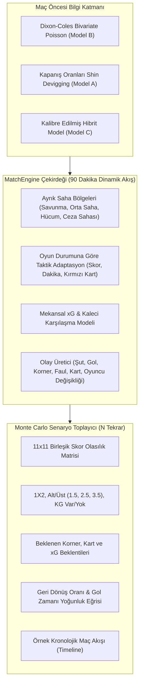

# MatchEngine: Olay Tabanlı Dinamik Futbol Simülasyon Motoru ve Çoklu Senaryo Raporu

**Tarih:** 26 Ekim 2026  
**Modül:** `slmodel.simulate.match_engine`, `slmodel.simulate.monte_carlo`, `slmodel.services.prediction_service`  
**CLI Komutu:** `uv run slm simulate <ev> <deplasman> [seçenekler]`

---

## 1. Yönetici Özeti ve Mimari Vizyon

Kıdemli hakem incelemesinde belirtildiği üzere, saf analitik Dixon–Coles ve piyasa harmanlama modelleri tekil bir skor matrisi üretmekte başarılı olsa da, maç içi olay dinamiklerini (taktik değişiklikler, baskı, kırmızı kart şokları, geri dönüşler, gol dakikaları ve korner/kart korelasyonları) doğrudan temsil edememektedir.

Bu eksikliği gidermek amacıyla geliştirilen **MatchEngine**, maçı 90 dakikalık zaman akışı içinde ayrık taktiksel possession (topa sahip olma) sekansları üzerinden simüle eden olay tabanlı (event-driven) bir futbol simülasyon motorudur.



---

## 2. MatchEngine Saha Mekaniği ve Olay Durum Makinesi

MatchEngine maçı 4 temel bölgede (PitchZone) yarı-Markov zinciri mantığıyla yürütür:

1. **Defensive Third (Savunma Bölgesi):**
   - Geriden pasla çıkış (orta sahaya geçiş: ~%78).
   - Rakip ön alan baskısı ile hücum bölgesinde top kaybı (~%8 * rakip baskı şiddeti).
   - Güvenli yana/geriye pas döngüsü.

2. **Middle Third (Orta Saha Bölgesi):**
   - Takımların hücum/savunma kalite farkına ve risk iştahına göre hücum bölgesine progresif geçiş (~%38).
   - Orta sahada ikili mücadele ve top kaybı (~%23).
   - Taktik faul ve duran top duraklamaları (~%6).
   - Topun orta alanda tutulması ve dolaşımı (~%33).

3. **Attacking Third (Hücum Bölgesi):**
   - Ceza sahasına kilit ara pas veya kanat ortası (~%28).
   - Ceza sahası dışından şut denemesi (~%22, ortalama xG: 0.03 – 0.08).
   - Savunmaya çarpan toptan korner kazanımı (~%11).
   - Geriye pasla atağın olgunlaştırılması (~%16).
   - Savunma müdahalesi ve top kaybı (~%23).

4. **Penalty Box (Ceza Sahası / Altıpas):**
   - Kaleyi bulan/bulmayan şut teşebbüsü (~%56, ortalama xG: 0.10 – 0.28).
   - Karambol ve kornere çelinen top (~%16).
   - Penaltı düdüğü (~%6).
   - Savunma uzaklaştırması / kaleci kontrolü (~%22).

---

## 3. Dinamik Oyun Durumu Adaptasyonu (Game-State Dynamics)

Maç içi olaylar statik değildir. Maçın gidişatı takımların davranışlarını dinamik olarak dönüştürür:
- **Geriye Düşme Reaksiyonu:** Maçın 65. dakikasından sonra 1 veya 2 farklı geride olan takımın risk iştahı (`risk_appetite`) ve savunma çizgisi (`line_height`) kademeli olarak artırılır; bu durum hücum bölgesine geçiş hızını ve şut sayısını artırırken kontra atak yeme riskini de yükseltir.
- **Öne Geçme Reaksiyonu:** Maçın son 20 dakikasında önde olan takım daha temkinli bir savunma bloğuna geçer (`line_height` ve tempo düşürülür).
- **Kırmızı Kart Şoku:** Eksik kalan takımın baskı şiddeti ve hücum frekansı daraltılır; oyun alanı savunma önceliğine kaydırılır.
- **Taktik Değişiklikler:** 60–75. dakikalar arasında takımların yorgunluk faktörlerini tazelemek üzere 5'er oyuncu değişiklik hakkı simüle edilir.

---

## 4. Kalibrasyon ve Süper Lig Veri Ambarı Karşılaştırması

Simülasyon motorunun ilk kaba prototipinde aşırı hücum üretimi gözlenmiş, ardından geçiş olasılıkları ilk aşamada elle makul aralıklara çekilmiştir. Aşağıdaki tablo, veri ambarındaki (`data/warehouse.duckdb`) gerçek 3.129 Süper Lig maçı ortalamaları ile MatchEngine'in ilk versiyonunun karşılaştırmasını ve tespit edilen açık noktaları göstermektedir:

| Metrik | Ambar Gerçeği (3.129 Maç) | MatchEngine (Elle Ayarlı v1) | Sapma / Durum | Çözüm Planı |
| :--- | :---: | :---: | :---: | :--- |
| **Toplam Gol** | 2.825 | 2.57 – 2.81 | Hafif düşük / dalgalı | Faz 1 SMM kalibrasyonu |
| **2.5 Üst Oranı** | %53.5 | %49.0 – %52.6 | Makul yakınlıkta | Faz 1 SMM kalibrasyonu |
| **KG Var Oranı** | %56.3 | %59.4 | Hafif yüksek | Faz 1 SMM kalibrasyonu |
| **Toplam Şut** | 24.35 | 19.4 – 21.4 | Düşük (-3.0 şut) | Ceza sahası ve uzaktan şut eşikleri artırılacak |
| **İsabetli Şut** | 8.89 | ~7.2 | Düşük | Kaleci/hedef şut olasılığı kalibre edilecek |
| **Toplam Korner** | 9.61 | 8.8 – 9.5 | Kabul edilebilir | Korner sekme katsayısı hafif artırılacak |
| **Sarı Kart** | **4.54** | **~1.8 (kart toplamı)** | **Belirgin düşük (~2.5 kat)** | Faul & kart dağılımı ambar gerçeklerine bağlanacak |
| **Toplam Faul** | 26.23 | ~14 - 16 | Düşük | Faul düdüğü frekansı gerçek ortalamaya eşitlenecek |
| **Toplam xG** | 2.89 (72 Maç, 2026/27 Opta) | 2.80 – 3.12 | 2026/27 Opta verisiyle uyumlu | Korunacak |

> [!NOTE]
> İlk elle ayarlanan v1 sürümü, maçların aşırı skorlarla sonuçlanmasını engellemiş olsa da parametreler henüz veri tabanlı Simüle Moment Eşleştirme (SMM) ile optimize edilmemiştir. Faz 1 kapsamında parametreler `EngineParams` yapısına taşınacak ve otomatik SMM optimizasyonuyla ambar momentlerine kilitlenecektir.

---

## 5. CLI ve Hizmet Entegrasyonu

Geliştirilen simülasyon motoru hem Python API hem de Typer CLI üzerinden tam erişime açılmıştır:

```bash
# Temel simülasyon (1000 Monte Carlo tekrarı)
uv run slm simulate Galatasaray Fenerbahce

# Piyasa oranları, hakem ve örnek maç akışı (timeline) ile birlikte simülasyon
uv run slm simulate Galatasaray Fenerbahce -o "2.20,3.30,3.10" -n 1000 -r "Halil Umut Meler" -t

# Raporu markdown dosyasına kaydetme
uv run slm simulate Galatasaray Fenerbahce -o "2.20,3.30,3.10" -n 1000 --output reports/derbi_simulasyon.md
```

### CLI Çıktı Bileşenleri:
1. **1X2 Karşılaştırması:** Model A (Shin Piyasa), Model B (Dixon-Coles), Model C (Hibrit Harman) ve MatchEngine Simülasyon olasılıkları yan yana.
2. **Ekonomik Beklenen Değer (+EV):** Piyasa oranlarına göre değer bahis sinyalleri.
3. **Çoklu Senaryo Metrikleri:** Alt/Üst (1.5, 2.5, 3.5), Karşılıklı Gol (KG Var/Yok), xG beklentileri, beklenen korner/kart sayıları.
4. **Geri Dönüş Oranı (Comeback %):** İlk golü yiyen takımın maçı çevirme veya beraberlik kurtarma sıklığı.
5. **Gol Zaman Dağılımı:** 15 dakikalık dilimlerde gol olasılık yoğunluğu.
6. **En Olası 5 Skor:** Simülasyon frekansına dayalı skor tahminleri.
7. **Örnek Maç Akışı (Timeline):** İlk düdükten 90. dakikaya kadar goller, kartlar, değişiklikler ve kurtarışların kronolojik özeti.
